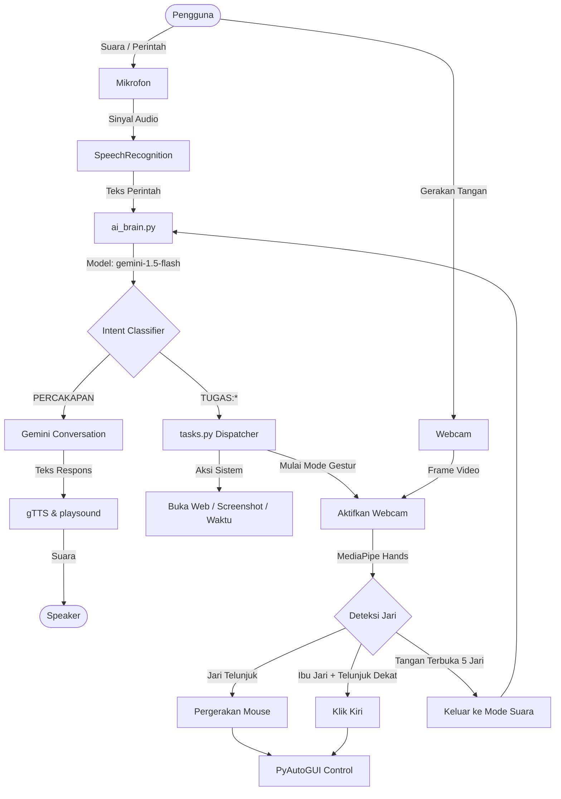

# 🤖 Jojo AI: Asisten Virtual Cerdas & Kontrol Gestur

<p align="center">
  
</p>

<p align="center">
  <strong>Asisten Virtual Desktop Masa Depan dengan Kecerdasan Google Gemini & Kontrol Hands-Free MediaPipe</strong>
</p>

<p align="center">
  <a href="LICENSE"></a>
  <a href="https://python.org"></a>
  <a href="https://github.com/ahmadzakiyox/Jojo-AI/releases"></a>
  <a href="https://github.com/ahmadzakiyox/Jojo-AI/issues"></a>
</p>

---

Jojo AI adalah sebuah asisten virtual desktop berbasis Python yang dirancang untuk berinteraksi secara natural menggunakan suara dan gerakan tangan (gestur). Ditenagai oleh model AI **Google Gemini (gemini-1.5-flash)**, Jojo AI mampu memahami percakapan kasual secara fleksibel serta melaksanakan berbagai tugas otomatisasi sistem dan kontrol kursor secara instan.

> [!NOTE]  
> Proyek ini kini dilisensikan di bawah **MIT License** sehingga lebih fleksibel untuk digunakan, dimodifikasi, dan didistribusikan ulang.

---

## 🎬 Demonstrasi Video

Klik gambar di bawah ini untuk melihat bagaimana Jojo AI mendengarkan perintah suara Anda dan beralih ke mode kontrol gestur tangan secara real-time:

<p align="center">
  <a href="https://github.com/ahmadzakiyox/DB/blob/main/vd.mp4" target="_blank">
    
  </a>
  <br>
  <em>(Klik gambar untuk memutar video demo)</em>
</p>

---

## 🔮 Fitur Utama & Kemampuan

| Kategori | Deskripsi Fitur | Teknologi |
| :--- | :--- | :--- |
| **🧠 Otak AI Gemini** | Klasifikasi intensi perintah pintar dan percakapan natural berbahasa Indonesia. | `gemini-1.5-flash` |
| **🗣️ Respons Suara** | Konversi teks-ke-suara yang lancar dengan ucapan natural bahasa Indonesia. | `gTTS`, `playsound` |
| **🖐️ Mode Gestur** | Kontrol kursor mouse desktop secara hands-free menggunakan kamera. | `OpenCV`, `MediaPipe` |
| **🌐 Integrasi Web** | Membuka situs web populer secara langsung (YouTube, Spotify, Instagram). | `webbrowser` |
| **⚙️ Profil Dinamis** | Kustomisasi nama AI, pembuat, kota, dan kepribadian asisten. | `jojo_profile.json` |
| **🖥️ Utilitas Sistem** | Ambil tangkapan layar (screenshot) dan perintah shutdown komputer terproteksi. | `PyAutoGUI` |

---

## 🏗️ Arsitektur Sistem

Bagaimana Jojo AI bekerja di balik layar:



---

## 🛠️ Prasyarat & Teknologi

Pastikan komputer Anda memenuhi spesifikasi berikut:
* **Bahasa Pemrograman:** Python 3.9 atau lebih baru.
* **API Key:** Google Gemini API Key (dapat diperoleh secara gratis melalui Google AI Studio).
* **Perangkat Keras:** Mikrofon aktif dan Webcam/Kamera (opsional, untuk mode gestur).

---

## ⚙️ Panduan Instalasi Lengkap

Ikuti langkah-langkah di bawah ini untuk memasang Jojo AI pada lingkungan lokal Anda:

### 1. Kloning Repositori
```bash
git clone https://github.com/ahmadzakiyox/Jojo-AI.git
cd Jojo-AI
```

### 2. Konfigurasi Lingkungan Virtual (Virtual Environment)
Kami sangat menyarankan penggunaan Virtual Environment agar tidak mengganggu dependensi sistem global Anda.

```bash
# Membuat virtual environment
python -m venv venv

# Mengaktifkan di Windows (PowerShell)
.\venv\Scripts\activate

# Mengaktifkan di macOS/Linux
source venv/bin/activate
```

### 3. Memasang Dependensi
Pasang semua pustaka yang dibutuhkan menggunakan berkas `requirements.txt`:
```bash
pip install -r requirements.txt
```

> [!TIP]
> **Catatan Instalasi PyAudio di Windows:**  
> Jika Anda mengalami kendala saat memasang `pyaudio`, Anda dapat memasangnya secara manual dengan perintah:
> ```bash
> pip install pipwin
> pipwin install pyaudio
> ```
> Atau unduh file `.whl` resmi PyAudio yang sesuai dengan versi Python Anda dari situs web unofficial binaries, lalu pasang menggunakan `pip install <nama_file.whl>`.

### 4. Pengaturan API Key & Variabel Lingkungan
Buat berkas `.env` pada direktori utama proyek dan tambahkan API Key Gemini Anda:
```env
GEMINI_API_KEY="YOUR_ACTUAL_GEMINI_API_KEY"
MIC_INDEX="" # Isi dengan indeks mikrofon spesifik jika diperlukan (opsional)
```

---

## 🚀 Cara Menjalankan & Penggunaan

Setelah semua konfigurasi selesai, jalankan file utama:
```bash
python main.py
```

### 🗣️ Interaksi Suara (Mode Default)
Setelah banner selamat datang muncul, tunggu hingga sistem menampilkan log `[SYSTEM] >> Mendengarkan...` dan katakan perintah Anda:

* **Sapaan & Percakapan:**
  * *"Halo Jojo"*
  * *"Kamu sedang apa?"*
* **Informasi:**
  * *"Jam berapa sekarang?"*
  * *"Siapa yang membuatmu?"*
* **Aksi Desktop & Web:**
  * *"Buka YouTube"*
  * *"Buka Spotify"*
  * *"Ambil screenshot"* (layar akan di-screenshot dalam hitungan mundur 3 detik dan disimpan ke Desktop)
* **Peralihan Mode & Keluar:**
  * *"Ambil alih kendali"* (untuk masuk ke mode gestur)
  * *"Keluar"* atau *"Matikan program"* (untuk mengakhiri program)

### 🖐️ Cara Menggunakan Mode Gestur Tangan
Saat Anda mengatakan **"Ambil alih kendali"**, kamera Anda akan menyala secara otomatis. Gunakan gerakan tangan di depan kamera dengan panduan berikut:

1. **Menggerakkan Kursor:** Angkat tangan Anda dan arahkan **Jari Telunjuk** Anda. Kursor mouse akan mengikuti gerakan jari telunjuk Anda di layar.
2. **Melakukan Klik:** Dekatkan ujung **Ibu Jari** dengan ujung **Jari Telunjuk** hingga jaraknya sangat dekat (< 4% dari lebar kamera). Sistem akan mengeksekusi klik kiri secara otomatis.
3. **Keluar dari Mode Gestur:** Tunjukkan telapak tangan terbuka dengan **5 jari terbuka lebar** ke arah kamera. Jojo AI akan mematikan kamera dan kembali ke mode pendengaran suara.

---

## ⚙️ Kustomisasi Profil Asisten

Anda dapat dengan mudah mengubah identitas, kepribadian, dan lokasi asisten virtual Anda dengan mengedit berkas [jojo_profile.json](jojo_profile.json):

```json
{
    "ai_name": "Jojo",
    "creator_name": "Ahmad Zaki",
    "default_city": "Tangerang",
    "personality_traits": [
        "ramah",
        "cerdas",
        "sedikit humoris",
        "selalu siap membantu"
    ],
    "favorite_quote": "Teknologi sejati adalah yang tidak terasa seperti teknologi."
}
```

---

## 📄 Lisensi (License)

Proyek ini dilisensikan di bawah **[MIT License](LICENSE)**. Anda bebas untuk menyalin, memodifikasi, mendistribusikan, dan menggunakan proyek ini baik untuk tujuan non-komersial maupun komersial dengan tetap menyertakan hak cipta dan lisensi asli.

---

<p align="center">
  Dibuat dengan ❤️ oleh <a href="https://github.com/ahmadzakiyox">Ahmad Zaki</a>
</p>
